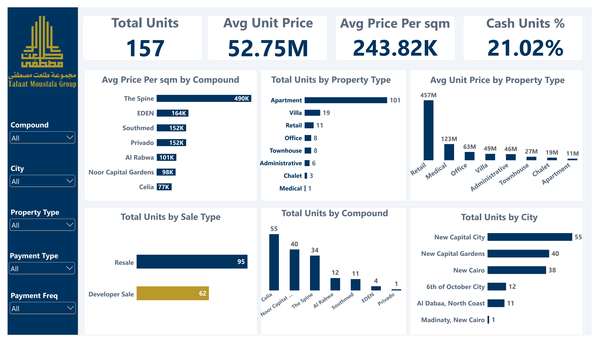

[# 🏢 End-To-End TMG Real Estate Portfolio Analytics

## 📌 Project Overview
An end-to-end interactive Business Intelligence dashboard analyzing real estate listings across **Talaat Moustafa Group (TMG)** developments in Egypt. Designed with an executive **Bento Grid** layout and styled strictly to match TMG’s corporate brand identity (`#003560` Navy & `#B8982B` Gold), this report transforms raw property listing data into actionable pricing, inventory, and payment structure insights.

## 🔗 Live Interactive Dashboard

[View the Live Dashboard Here](YOUR_POWER_BI_LINK_HERE)

---

## 📋 Dataset Scope & Coverage
> **Data Collection & Disclaimer:** This dataset was collected via **web scraping** from the **Nawy** real estate platform and represents a **curated market sample of 157 publicly listed property units** across Talaat Moustafa Group (TMG) developments. Because it captures a focused snapshot of available market offerings rather than TMG's complete internal historical sales records, findings reflect current public listings within this sample.

### **Included Data Attributes:**
* **Developments & Geography:** Compound name (*Celia, Noor Capital Gardens, The Spine, Al Rabwa, Southmed, EDEN, Privado*) and City (*New Capital City, New Capital Gardens, New Cairo, 6th of October City, Al Dabaa - North Coast, Madinaty*).
* **Property Specifications:** Unit classification (*Apartment, Villa, Retail, Office, Townhouse, Administrative, Chalet, Medical*) and built-up area in square meters (`Area_sqm`).
* **Pricing & Valuation:** Total unit price in EGP (`Price_EGP`) and unit valuation per square meter (`Price_per_sqm`).
* **Sales & Payment Terms:** Sale channel (`Resale` vs. `Developer Sale`), payment method (`Cash` vs. `Installments`), installment duration, and payment frequency.

---

## 🧹 Data Cleaning & Transformation (Power Query)
Raw scraped property listings required extensive preprocessing in **Power Query** before modeling:
* **Schema & Noise Removal:** Dropped redundant web-scraping metadata, empty columns, and duplicate listing entries to retain 157 clean, unique property records.
* **Text Parsing & Delimiter Splitting:** Extracted clean **Compound Names**, **Cities**, and **Property Types** from combined raw listing titles using delimiter splitting and text trimming.
* **Handling Fragmented Area Columns:** Consolidated split built-up area fields (where unit sizes appeared across separate columns depending on property type) into a single unified `Area_sqm` numeric column using conditional logic, and removed obsolete source columns.
* **Currency & Numeric Standardization:** Stripped text suffixes (e.g., `"EGP"`, `"m²"`, `"Years"`) and commas from price, area, and installment fields, casting all metrics into proper `Decimal Number` and `Whole Number` data types.
* **Standardizing Categorical Values:** Normalized inconsistent labels across `Sale_Type` (*Developer Sale* vs. *Resale*), `Payment_Type` (*Cash* vs. *Installments*), and `Payment_Freq` (*Monthly*, *Quarterly*, etc.), while handling `null` values for cash-only units.
* **Calculated Feature Engineering:** Created a clean `Price_per_sqm` column (`Price_EGP / Area_sqm`) to enable standardized valuation comparisons across different unit sizes and compounds.

---

## 📐 DAX Modeling & Visualization (Power BI)
1. **DAX Measures & KPIs:**
   * Engineered dynamic measures for `Total Units`, `Avg Unit Price`, `Avg Price Per sqm`, and `Cash Units %` to respond seamlessly to user filters.
2. **Executive Dashboard Design:**
   * Built a custom SVG **Bento Grid** layout aligned with TMG’s official color palette (`#003560` & `#B8982B`) and clean visual hierarchy.
   * Integrated five interactive slicers (*Compound, City, Property Type, Payment Type, and Payment Freq*) for multi-dimensional market exploration.

---

## 📊 Key Insights from the Sample
| Metric / Dimension | Key Finding |
| :--- | :--- |
| **Portfolio Valuation** | Average unit price stands at **52.75M EGP**, with an overall average of **243.82K EGP/sqm**. |
| **Top-Priced Development** | **The Spine** leads all compounds in price per square meter at **490K EGP/sqm**, followed by **EDEN** (**164K EGP/sqm**). |
| **Inventory Mix** | **Apartments** represent the largest share of listed units (**101 units**), while **Retail** commands the highest average unit price (**457M EGP**). |
| **Market Channel Split** | **Resale** listings (**95 units**) outnumber **Developer Sale** units (**62 units**) within the analyzed sample. |
| **Payment Dynamics** | **21.02%** of available units are offered for **Cash** payment, while **New Capital City** holds the highest concentration of listings (**55 units**). |

---

## 📂 Repository Structure
* `Talaat_Moustafa_Real_Estate.pbix` — Interactive Power BI Desktop report file.
* `TMG.xlsx` — Cleaned dataset of the 157 TMG property listings from Nawy.
* `Talaat_Moustafa_Real_Estate.png` — High-resolution export of the final dashboard.

---

## 👤 Author
**Yahia Farag** — Data Analyst  
*Tools: Power BI · Power Query · DAX · Excel*
](https://app.powerbi.com/view?r=eyJrIjoiMTA0MTIwOTUtY2ZiZi00MTQ2LTg4YTMtNGM0ZWYzOGUwNDM1IiwidCI6IjJiYjZlNWJjLWMxMDktNDdmYi05NDMzLWMxYzZmNGZhMzNmZiIsImMiOjl9)
